# AI-Powered Resume Builder

> A full-stack application for creating, importing, editing, scoring, and exporting professional resumes.

The AI-Powered Resume Builder combines editable resume templates, structured resume data, deterministic ATS scoring, AI-assisted resume import, and browser-based PDF export in one workflow.

## System Architecture

> For detailed component boundaries, data contracts, and architectural decisions, see the dedicated [System Architecture Documentation](docs/SYSTEM_ARCHITECTURE.md).

```mermaid
flowchart TD
    %% Styling Classes (Dark-Theme Optimized)
    classDef client fill:#0f172a,stroke:#38bdf8,stroke-width:2px,color:#f8fafc;
    classDef server fill:#1e1b4b,stroke:#a855f7,stroke-width:2px,color:#f8fafc;
    classDef process fill:#042f2e,stroke:#34d399,stroke-width:2px,color:#f8fafc;
    classDef scoring fill:#2e1065,stroke:#c084fc,stroke-width:2px,color:#f8fafc;
    classDef ai fill:#172554,stroke:#60a5fa,stroke-width:2px,color:#f8fafc;
    classDef storage fill:#1c1917,stroke:#fbbf24,stroke-width:2px,color:#f8fafc;
    classDef error fill:#450a0a,stroke:#f87171,stroke-width:2px,color:#fecaca;

    subgraph CLIENT ["Client Tier (Browser)"]
        User["👤 User / Browser"]
        ReactUI["⚛️ React + Vite UI<br/>(Editor, Form Controls & Document View)"]
        ClientState["🔄 Resume State and API Client<br/>(Client State & HTTP Bridge)"]
        Preview["👁️ Template Renderer and Resume Preview<br/>(Dynamic Template Component)"]
        PDFExport["📄 Browser PDF Export<br/>(html2canvas & jsPDF)"]
    end

    subgraph GATEWAY ["API Gateway & Routing"]
        ExpressAPI["⚡ Express REST API<br/>(Authentication, Multer Uploads & CORS)"]
    end

    subgraph BACKEND ["Backend Services & Logic"]
        ResumeCtrl["💼 Resume Controller and Service<br/>(CRUD, Versioning & Business Rules)"]
        ImportPipe["📥 Resume Import Pipeline<br/>(File Parsing & Upload Processing)"]
        GeminiExtract["🤖 Gemini API Extraction<br/>(AI-Assisted Extraction where configured)"]
        SectionMap["📋 Section Mapping & Validation<br/>(Map to Canonical Resume Structure)"]
        Norm["⚙️ Section Normalization<br/>(Canonical Resume Schema Validation)"]
        ATS["🎯 ATS Scoring<br/>(Deterministic Scoring & Keyword Engine)"]
    end

    subgraph INTELLIGENCE ["AI & Retrieval Services (Optional / Conditional)"]
        RAG["🧠 AI + RAG Service<br/>(Prompt Context Enrichment)"]
        VectorStore["📚 Vector Store / Chroma<br/>(Optional Context Embeddings)"]
        GeminiGen["🤖 Gemini API Generation<br/>(AI-Assisted Writing & Analysis)"]
    end

    subgraph PERSISTENCE ["Persistence Tier"]
        MongoDB[("🗄️ MongoDB Persistence<br/>(Resumes, Versions & User Accounts)")]
    end

    subgraph ERRORS ["Error & Fallback Handling"]
        ValidationError["⚠️ Validation / Parse Error<br/>(400 Bad Request / 422 Unprocessable)"]
    end

    %% Flow 1: Resume Editing, Preview & PDF Export
    User -->|"1. Edits resume sections"| ReactUI
    ReactUI -->|"Updates local resume state"| ClientState
    ClientState -->|"Supplies active sections"| Preview
    User -->|"Triggers PDF export"| Preview
    Preview -->|"Captures rendered layout"| PDFExport
    PDFExport -->|"Downloads resume PDF"| User

    %% Flow 2: Save and Persistence
    ClientState -->|"Dispatches save / update request"| ExpressAPI
    ExpressAPI -->|"Routes save request"| ResumeCtrl
    ResumeCtrl -->|"Validates sections"| Norm
    Norm -->|"Valid canonical schema"| MongoDB
    MongoDB -->|"Persisted resume record"| ResumeCtrl
    ResumeCtrl -->|"200 OK / saved snapshot"| ExpressAPI
    ExpressAPI -->|"Rehydrates active resume state"| ClientState
    Norm -.->|"Validation failure"| ValidationError

    %% Flow 3: Resume Import Pipeline
    User -->|"2. Uploads file (PDF/DOCX/TXT/JSON)"| ReactUI
    ReactUI -->|"POST /api/resume/import (multipart)"| ExpressAPI
    ExpressAPI -->|"Routes raw file stream"| ImportPipe
    ImportPipe -->|"Optional: Raw text for AI extraction"| GeminiExtract
    GeminiExtract -->|"Structured JSON candidate"| ImportPipe
    ImportPipe -->|"Parsed text / candidate data"| SectionMap
    SectionMap -->|"Normalized section candidates"| Norm
    Norm -->|"Populates form for user review"| ClientState
    ImportPipe -.->|"Unsupported / corrupt file"| ValidationError
    ValidationError -.->|"Returns error status (400/422)"| ExpressAPI
    ExpressAPI -.->|"Displays error notification"| ReactUI

    %% Flow 4: ATS Scoring
    User -->|"3. Requests ATS evaluation"| ReactUI
    ReactUI -->|"POST /api/ats/score"| ExpressAPI
    ExpressAPI -->|"Job description & resume content"| ATS
    ATS -->|"Deterministic score & analysis"| ExpressAPI
    ExpressAPI -->|"Renders ATS results"| ReactUI

    %% Flow 5: AI + RAG Workflows
    ResumeCtrl -.->|"Enrichment query (if configured)"| RAG
    RAG -.->|"Retrieve nearest context"| VectorStore
    VectorStore -.->|"Retrieved context documents"| RAG
    RAG -.->|"Augmented prompt"| GeminiGen
    GeminiGen -.->|"Enriched content suggestion"| ResumeCtrl

    %% Class Assignments
    class User,ReactUI,ClientState,Preview,PDFExport client;
    class ExpressAPI,ResumeCtrl server;
    class ImportPipe,GeminiExtract,SectionMap,Norm process;
    class ATS scoring;
    class RAG,VectorStore,GeminiGen ai;
    class MongoDB storage;
    class ValidationError error;
```



### Component Responsibilities

| Component | Responsibility | Boundary |
|---|---|---|
| **React + Vite UI** | Presents the builder, section editor, template picker, preview, and download controls. | Runs in the user's browser. |
| **Resume State & API Client** | Holds the active resume and editing/save-state metadata used by the builder; issues HTTP requests. | Client-side state; persistence occurs through API calls. |
| **Template Renderer & Preview** | Renders resume section data into the selected visual template layout in real-time. | Client browser presentation layer. |
| **Browser PDF Exporter** | Captures the rendered resume DOM using `html2canvas` and generates a downloadable PDF via `jsPDF`. | Runs entirely in the browser; no server rendering dependency. |
| **Express REST API** | Handles incoming requests, enforces CORS, validates authentication tokens, and coordinates uploads. | Server-side entry point. |
| **Resume Controller & Service** | Orchestrates resume CRUD operations, version snapshots, and business workflows. | Backend application layer. |
| **Resume Import Pipeline** | Receives uploaded files (PDF, DOCX, TXT, JSON), parses raw content, invokes AI extraction, and maps sections. | Server-side in-memory processing. |
| **Section Normalization** | Validates and sanitizes resume section data against canonical application schemas. | Server-side domain layer. |
| **ATS Scoring** | Produces deterministic ATS scoring and actionable keyword feedback from resume and job inputs. | Server-side deterministic engine. |
| **AI + RAG Service** | Coordinates retrieval from vector storage and enriches LLM prompts with relevant context. | Optional server-side service. |
| **MongoDB Persistence** | Persists resume data, version histories, and user account credentials. | Database tier. |
| **Gemini API** | Provides cloud LLM capabilities for structured import extraction and content generation where configured. | External provider; requires API key. |

### Primary Data Flows

#### 1. Resume Editing and Persistence
1. The user edits a structured section in the frontend.
2. Client state reflects the edit, and the save flow calls the Express REST API.
3. The backend routes the request through the resume controller and service layer.
4. Section normalization verifies data integrity and schema compliance.
5. The server persists the updated resume to MongoDB and returns the updated document.
6. The client rehydrates the editor with the saved state.

#### 2. Importing an Existing Resume
1. The user uploads a supported resume file (PDF, DOCX, TXT, or JSON).
2. The backend validates the upload and parses the document text in memory.
3. When configured, the Gemini API extracts raw text into structured section candidates.
4. Parsed fields are validated and mapped to the canonical resume section structure.
5. The editor displays the editable fields for user review and correction.
6. The normal save flow persists the approved resume data to MongoDB.

#### 3. Template Rendering and PDF Export
1. The client passes resume sections and template metadata to the selected template component.
2. The template renders the resume in the browser preview.
3. Browser PDF export captures the rendered layout using `html2canvas`.
4. `jsPDF` compiles the captured layout into a multi-page PDF document.
5. The user downloads the generated PDF directly in the browser.

#### 4. ATS Scoring and AI Workflows
1. ATS scoring runs deterministic server-side algorithms against resume content and target job criteria.
2. For AI-assisted writing or generation, the controller invokes the RAG service.
3. When the vector store is initialized, RAG queries Chroma for relevant domain context.
4. The enriched prompt is forwarded to the Gemini API, and suggested improvements are returned.
5. If RAG or Gemini is unconfigured, the system gracefully degrades to core functionality.

### Architectural Decisions and Constraints

- **Structured data first:** Resume sections are represented as data rather than being hardcoded into template JSX.
- **Separate content from presentation:** The template renderer controls visual styling; resume records supply raw content.
- **Client-side PDF generation:** PDF export uses client-side rendering via `html2canvas` and `jsPDF`, removing server rendering bottlenecks.
- **Review before persistence:** Imported resumes are mapped into editable form fields so users can verify accuracy before saving.
- **Graceful degradation:** AI extraction and RAG retrieval are optional; core editing, rendering, scoring, and export operate without external AI credentials.

### Configuration and Deployment Boundaries

A production deployment typically requires:
- Frontend API base URL configured to point to the backend server.
- Backend allowed origin (`CORS_ORIGIN`) matching the frontend deployment URL.
- MongoDB connection string configured for production persistence.
- Optional Gemini API key (`GEMINI_API_KEY`) for AI-assisted import extraction and content generation.
- Optional Google Sign-In credentials when Google authentication is enabled.

Consult `.env.example` files in `client/` and `server/` for exact variable names.

### Operational Verification

Before releasing changes:
- Verify authentication flows (email and Google Sign-In if enabled).
- Test resume creation, section editing, saving, and reloading.
- Test resume import with each supported format (PDF, DOCX, TXT, JSON).
- Confirm template rendering and page layout fidelity across templates.
- Check PDF download for proper page breaks, typography, and visual completeness.
- Validate ATS scoring and AI workflows when configured.
- Ensure no credentials, `.env` files, or temporary files are committed.

## Overview

Users can create a resume from editable sections or import an existing file, review the extracted information, choose a resume template, preview the result, and export the finished resume to PDF. Resume content is stored as structured section data so the editor and template renderer can work from the same underlying model.

## Features

- **Editable resume builder** — manage personal information, summary, education, experience, skills, projects, certifications, and research/publication details.
- **Multiple resume templates** — switch between supported layouts while keeping resume content separate from template presentation.
- **Live preview** — inspect the rendered resume while editing.
- **PDF export** — generate a PDF from the browser-rendered resume layout.
- **ATS scoring** — calculate a deterministic score using resume content and job-related inputs.
- **AI-assisted import** — upload supported PDF, DOCX, TXT, or JSON files; extracted data is validated and mapped into editable resume sections.
- **Authentication** — email-based and Google sign-in flows, with server-side authentication configuration.
- **Resume persistence and versions** — save and reload resumes through the API; version endpoints are present in the resume service.
- **AI prompt enrichment** — a retrieval-augmented generation (RAG) service can provide relevant context from a vector store to supported generation and analysis workflows.
- **Development diagnostics** — HTTP/ATS timing logs and validation utilities help diagnose issues.

## Technology Stack

| Area | Technology / responsibility |
|---|---|
| Frontend | React, Vite, JavaScript, CSS |
| Backend | Node.js, Express |
| Persistence | MongoDB via the server data/model layer |
| AI workflows | Google Gemini where the relevant workflow requires it |
| Retrieval | Chroma/vector-store integration for RAG, when initialized and configured |
| Authentication | Email/Google sign-in flows and JWT-related server configuration |
| PDF export | `html2canvas` and `jsPDF` in the browser |
| Testing and maintenance | Client test files and repository validation scripts |

## Repository Structure

```text
Building AI-Powered Resume Builder/
├── client/
│   ├── src/
│   │   ├── components/       # Builder UI, preview, selectors, resume templates
│   │   ├── config/           # Client-side configuration
│   │   ├── constants/        # Template metadata and shared constants
│   │   ├── context/          # Resume editor state management
│   │   ├── pages/            # Application pages
│   │   └── services/         # API client calls
│   └── tests/                # Focused client tests and fixtures
├── server/
│   └── src/
│       ├── config/           # Database, provider, and vector-store configuration
│       ├── constants/        # Server-side constants and prompts
│       ├── controllers/      # HTTP request handlers
│       ├── models/           # Persistence models
│       ├── services/         # Resume, import, ATS, and RAG business logic
│       └── utils/            # Normalization and shared utilities
├── scripts/                  # Validation and repository utilities
├── docs/
│   └── SYSTEM_ARCHITECTURE.md# Comprehensive architecture documentation
└── README.md
```

Some directories or files may differ by branch; use the checked-out repository as the source of truth.

## Setup

### 1. Prerequisites

- Node.js and npm
- A MongoDB instance or connection string for the backend
- Gemini credentials for workflows that use AI extraction or generation
- Google sign-in configuration if Google authentication is enabled

### 2. Configure environment files

Create local environment files from the repository examples:

- Copy `server/.env.example` to `server/.env`.
- Copy `client/.env.example` to `client/.env`.

Populate only the variables required by the features you intend to run. Use the example files as the authority for the exact variable names and expected values. Configure database access, authentication, AI provider credentials, the frontend API base URL, and the allowed frontend origin as applicable.

**Never commit `.env` files, access tokens, passwords, private keys, or API credentials.**

### 3. Install dependencies

Use the package manager and lockfiles present in your checkout. Install dependencies from the project root and/or the `client` and `server` folders as indicated by the relevant `package.json` files. Do not mix package managers in the same working tree.

### 4. Start the development environment

From the project root:

```bash
npm run dev
```

The documented root development script starts the API on port `5000` and the Vite frontend together. Press `Ctrl+C` to stop both services.

To run one service intentionally, use the root scripts if present:

```bash
npm run dev:server
npm run dev:client
```

Resume upload/import flows require the API to be running; starting Vite alone is not sufficient.

## Resume Import Flow

1. Open the resume editor and choose **Upload Existing Resume**.
2. Select a supported PDF, DOCX, TXT, or JSON file.
3. The upload is validated and parsed. Gemini extraction is used when required by the configured import workflow.
4. Extracted fields are validated and mapped to the existing resume section model.
5. Review and correct the information in the editor.
6. Save using the normal resume save flow. Uploading a file does not necessarily mean the resume has already been persisted.

## Testing and Validation

Before committing a change:

1. Run the relevant test or validation command configured by the project.
2. Start the application and test the affected workflow manually.
3. For template changes, verify both the on-screen preview and downloaded PDF.
4. For API/import changes, inspect browser Network requests and backend logs.
5. Confirm that the resume still saves and reloads without losing section data.

The repository includes focused tests under `client/tests/` and utility scripts under `scripts/`. Check each script and the relevant `package.json` before assuming a command is available or part of the default build.

## Deployment Checklist

- [ ] Configure production environment variables in the hosting platform.
- [ ] Set the backend's allowed frontend origin to the production frontend URL.
- [ ] Point the frontend API base URL to the deployed backend URL.
- [ ] Configure MongoDB network access and production credentials.
- [ ] Configure Gemini and Google sign-in as required by enabled features.
- [ ] Confirm that no secrets or local-only files are included in the commit.
- [ ] Deploy the backend and frontend according to the hosting configuration.
- [ ] Verify sign-in, resume creation/editing, save/reload, import, template preview, ATS scoring, and PDF export in production.

## Security

- Keep secrets out of source control and frontend bundles.
- Use production-specific credentials and restrictive origin configuration.
- Validate uploaded files and treat extracted content as untrusted input.
- Review staged files before every commit, especially environment files, local agent settings, generated caches, and temporary artifacts.
- Do not expose server-only AI credentials in client-side configuration.

## Troubleshooting

### Upload or import fails

- Confirm that the backend is running and reachable.
- Inspect the browser Network panel for the failing request, response status, and response body.
- Check backend logs for file parsing, validation, database, or AI-provider errors.
- Confirm the accepted file type/size and required environment variables.

### The frontend loads but API requests fail

- Verify that the frontend API base URL points to the correct backend.
- Confirm that the backend is running on the configured port and that the allowed origin matches the frontend URL.
- In production, check the deployed frontend and backend URLs and their HTTPS configuration.

### AI-assisted features are unavailable

- Verify the relevant backend credential and provider configuration.
- Review provider quota/availability errors in the backend logs.
- Check whether the workflow can operate without AI/RAG context or requires the provider to be configured.

### Research/publication data does not appear in a template

- Verify that the saved resume response contains the expected publication data.
- Check the section normalizer and the template's render condition.
- Test both preview and PDF export after correcting the actual data-flow issue; avoid hardcoding user content into a template component.

## Contributing

1. Create a focused branch for the change.
2. Keep the change scoped to the intended feature.
3. Run relevant tests and validation scripts.
4. Verify the affected user workflow and generated PDF where applicable.
5. Commit with a clear, specific message.
