# System Architecture & Component Specification

> Comprehensive architectural reference, data flows, and component interactions for the AI-Powered Resume Builder.

---

## 1. Architectural Overview & Workflow Flowchart

The following top-to-bottom flowchart illustrates the complete lifecycle of data across the client application, API gateway, domain processing services, intelligence layer, and persistent storage.

```mermaid
flowchart TD
    %% Styling Classes (Dark-Theme Optimized)
    classDef client fill:#0f172a,stroke:#38bdf8,stroke-width:2px,color:#f8fafc;
    classDef server fill:#1e1b4b,stroke:#a855f7,stroke-width:2px,color:#f8fafc;
    classDef process fill:#042f2e,stroke:#34d399,stroke-width:2px,color:#f8fafc;
    classDef scoring fill:#2e1065,stroke:#c084fc,stroke-width:2px,color:#f8fafc;
    classDef ai fill:#172554,stroke:#60a5fa,stroke-width:2px,color:#f8fafc;
    classDef storage fill:#1c1917,stroke:#fbbf24,stroke-width:2px,color:#f8fafc;
    classDef error fill:#450a0a,stroke:#f87171,stroke-width:2px,color:#fecaca;

    subgraph CLIENT ["Client Tier (Browser)"]
        User["👤 User / Browser"]
        ReactUI["⚛️ React + Vite UI<br/>(Editor, Form Controls & Document View)"]
        ClientState["🔄 Resume State and API Client<br/>(Client State & HTTP Bridge)"]
        Preview["👁️ Template Renderer and Resume Preview<br/>(Dynamic Template Component)"]
        PDFExport["📄 Browser PDF Export<br/>(html2canvas & jsPDF)"]
    end

    subgraph GATEWAY ["API Gateway & Routing"]
        ExpressAPI["⚡ Express REST API<br/>(Authentication, Multer Uploads & CORS)"]
    end

    subgraph BACKEND ["Backend Services & Logic"]
        ResumeCtrl["💼 Resume Controller and Service<br/>(CRUD, Versioning & Business Rules)"]
        ImportPipe["📥 Resume Import Pipeline<br/>(File Parsing & Upload Processing)"]
        GeminiExtract["🤖 Gemini API Extraction<br/>(AI-Assisted Extraction where configured)"]
        SectionMap["📋 Section Mapping & Validation<br/>(Map to Canonical Resume Structure)"]
        Norm["⚙️ Section Normalization<br/>(Canonical Resume Schema Validation)"]
        ATS["🎯 ATS Scoring<br/>(Deterministic Scoring & Keyword Engine)"]
    end

    subgraph INTELLIGENCE ["AI & Retrieval Services (Optional / Conditional)"]
        RAG["🧠 AI + RAG Service<br/>(Prompt Context Enrichment)"]
        VectorStore["📚 Vector Store / Chroma<br/>(Optional Context Embeddings)"]
        GeminiGen["🤖 Gemini API Generation<br/>(AI-Assisted Writing & Analysis)"]
    end

    subgraph PERSISTENCE ["Persistence Tier"]
        MongoDB[("🗄️ MongoDB Persistence<br/>(Resumes, Versions & User Accounts)")]
    end

    subgraph ERRORS ["Error & Fallback Handling"]
        ValidationError["⚠️ Validation / Parse Error<br/>(400 Bad Request / 422 Unprocessable)"]
    end

    %% Flow 1: Resume Editing, Preview & PDF Export
    User -->|"1. Edits resume sections"| ReactUI
    ReactUI -->|"Updates local resume state"| ClientState
    ClientState -->|"Supplies active sections"| Preview
    User -->|"Triggers PDF export"| Preview
    Preview -->|"Captures rendered layout"| PDFExport
    PDFExport -->|"Downloads resume PDF"| User

    %% Flow 2: Save and Persistence
    ClientState -->|"Dispatches save / update request"| ExpressAPI
    ExpressAPI -->|"Routes save request"| ResumeCtrl
    ResumeCtrl -->|"Validates sections"| Norm
    Norm -->|"Valid canonical schema"| MongoDB
    MongoDB -->|"Persisted resume record"| ResumeCtrl
    ResumeCtrl -->|"200 OK / saved snapshot"| ExpressAPI
    ExpressAPI -->|"Rehydrates active resume state"| ClientState
    Norm -.->|"Validation failure"| ValidationError

    %% Flow 3: Resume Import Pipeline
    User -->|"2. Uploads file (PDF/DOCX/TXT/JSON)"| ReactUI
    ReactUI -->|"POST /api/resume/import (multipart)"| ExpressAPI
    ExpressAPI -->|"Routes raw file stream"| ImportPipe
    ImportPipe -->|"Optional: Raw text for AI extraction"| GeminiExtract
    GeminiExtract -->|"Structured JSON candidate"| ImportPipe
    ImportPipe -->|"Parsed text / candidate data"| SectionMap
    SectionMap -->|"Normalized section candidates"| Norm
    Norm -->|"Populates form for user review"| ClientState
    ImportPipe -.->|"Unsupported / corrupt file"| ValidationError
    ValidationError -.->|"Returns error status (400/422)"| ExpressAPI
    ExpressAPI -.->|"Displays error notification"| ReactUI

    %% Flow 4: ATS Scoring
    User -->|"3. Requests ATS evaluation"| ReactUI
    ReactUI -->|"POST /api/ats/score"| ExpressAPI
    ExpressAPI -->|"Job description & resume content"| ATS
    ATS -->|"Deterministic score & analysis"| ExpressAPI
    ExpressAPI -->|"Renders ATS results"| ReactUI

    %% Flow 5: AI + RAG Workflows
    ResumeCtrl -.->|"Enrichment query (if configured)"| RAG
    RAG -.->|"Retrieve nearest context"| VectorStore
    VectorStore -.->|"Retrieved context documents"| RAG
    RAG -.->|"Augmented prompt"| GeminiGen
    GeminiGen -.->|"Enriched content suggestion"| ResumeCtrl

    %% Class Assignments
    class User,ReactUI,ClientState,Preview,PDFExport client;
    class ExpressAPI,ResumeCtrl server;
    class ImportPipe,GeminiExtract,SectionMap,Norm process;
    class ATS scoring;
    class RAG,VectorStore,GeminiGen ai;
    class MongoDB storage;
    class ValidationError error;
```

---

## 2. Component Boundaries and Responsibilities

| Component | Responsibility | Execution Boundary |
|---|---|---|
| **React + Vite UI** | Interactive builder interface, dynamic section forms, template selector, live resume preview, and PDF trigger. | Client browser |
| **Resume State & API Client** | Manages active resume state, dirty tracking, and handles HTTP communication with backend endpoints. | Client browser |
| **Template Renderer & Resume Preview** | Renders resume section data into selected visual layouts (e.g., Creative Clean, AIML Engineer) maintaining strict separation of data and presentation. | Client browser |
| **Browser PDF Export (`html2canvas` + `jsPDF`)** | Renders DOM canvas and builds multipage PDF client-side without requiring server-side rendering microservices. | Client browser |
| **Express REST API** | Entry point for HTTP requests; provides routing, authentication token validation, CORS enforcement, and multipart file upload handling via Multer. | Backend Node.js server |
| **Resume Controller & Service** | Executes resume CRUD operations, version control, and orchestrates calls to normalization, persistence, and external services. | Backend Node.js server |
| **Resume Import Pipeline** | Handles multi-format file uploads (PDF, DOCX, TXT, JSON), text extraction, and feeds extracted text to AI parsing when required. | Backend Node.js server |
| **Section Normalization** | Validates and sanitizes raw user inputs or parsed resume data against the canonical resume schema before storage. | Backend Node.js server |
| **ATS Scoring Engine** | Performs deterministic keyword matching, section completeness scoring, and job description alignment calculations. | Backend Node.js server |
| **AI + RAG Service** | Coordinates context retrieval and enriches prompts with relevant domain context when vector retrieval is enabled. | Backend Node.js server |
| **Vector Store / Chroma (Optional)** | Stores embeddings for contextual retrieval; queried when RAG workflows are enabled. | Backend / Local Service |
| **Google Gemini API** | Provides cloud LLM capabilities for structured resume data extraction and content optimization. | External Cloud Provider |
| **MongoDB Persistence** | Persists resume documents, version history, and user authentication records via Mongoose schemas. | Database tier |

---

## 3. Primary Data Flows

### 3.1 Resume Editing and Persistence Flow

1. The user inputs or edits structured resume fields (contact information, summary, experience, education, skills, projects, certifications, or publications).
2. The React client updates its local `ResumeContext` state and marks the state dirty.
3. Upon save (manual or auto-save), the API client issues an authenticated `POST` or `PUT` request to `/api/resumes`.
4. The Express API verifies the user session and forwards the payload to `resume.controller.js`.
5. `resume.service.js` invokes `sectionNormalizer.js` to ensure all sections adhere to canonical data structures.
6. The validated resume document is written to MongoDB via Mongoose models, and a version snapshot is optionally recorded.
7. The server returns HTTP 200 with the saved resume data, confirming persistence and synchronizing client state.

### 3.2 Resume Import Pipeline Flow

1. The user selects **Upload Existing Resume** in the browser and submits a PDF, DOCX, TXT, or JSON file.
2. The browser sends a multipart form request to `/api/resume/import`.
3. Multer buffers the uploaded file in memory. The parser extracts raw text from the document stream.
4. If AI-assisted extraction is configured, the extracted text is structured into JSON using the Gemini API.
5. The extracted sections are mapped and passed through section normalization to validate schema consistency.
6. The normalized data is returned to the client as an editable draft.
7. The user reviews and refines the imported content in the editor; database persistence occurs only when the user explicitly triggers a save.

### 3.3 Template Rendering and Browser PDF Export Flow

1. The client passes normalized resume sections to the active template component.
2. The template applies typography and styling rules to present a print-accurate layout.
3. When the user clicks **Download PDF**, `html2canvas` captures the rendered DOM nodes at 2x resolution.
4. `jsPDF` slices the resulting canvas into A4 or Letter page heights, avoiding split lines across boundaries where configured.
5. The finished PDF file is downloaded directly in the user's browser without incurring backend compute load.

### 3.4 Deterministic ATS Scoring Flow

1. The user initiates ATS scoring with an optional job description.
2. The client transmits current resume sections and target criteria to `/api/ats/score`.
3. The server-side ATS service executes deterministic scoring rules:
   - Section completeness and contact validation
   - Experience and bullet point action-verb density
   - Keyword overlap and skills relevance against job descriptions
4. The calculated score and actionable suggestions are cached against the hash of the inputs and returned to the client.

### 3.5 AI & Retrieval-Augmented Generation (RAG) Flow

1. For AI-assisted writing or skill suggestions, the controller queries the `RAGService`.
2. When Chroma/vector store is initialized, relevant reference embeddings are queried.
3. Retrieved reference context is combined with user inputs into an enriched prompt.
4. The prompt is sent to Google Gemini, which returns structured recommendations.
5. If RAG is unconfigured, the system gracefully degrades to direct prompt generation or deterministic fallbacks.

---

## 4. Architectural Decisions and Constraints

- **Single Canonical Data Contract:** All templates consume the same normalized section schema. Templates never store state or dictate the schema.
- **Client-Side Document Export:** PDF generation occurs entirely within the client browser, reducing server load and eliminating headless browser dependencies in production.
- **Explicit Review Gate:** Imported resumes are always surfaced in the editor for user validation prior to database persistence.
- **Graceful Intelligence Degradation:** AI and RAG services are optional; core editing, template rendering, ATS scoring, and PDF export function without active LLM credentials.
- **Deterministic Scoring Isolation:** ATS calculations rely on predictable algorithms rather than non-deterministic model completions.

---

## 5. Related Documentation

- [Project README](../README.md)
- [Project Rules](../PROJECT_RULES.md)
